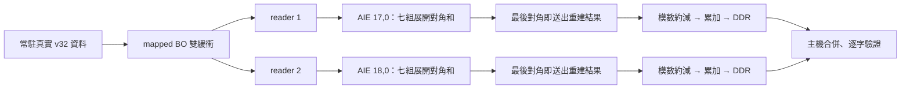

# 本輪離線結果與限制

原版維持七組精確對角和與 84-bit reciprocal reducer。本輪只改 AIE 對角和排程及 reducer 重建輸出階段，保持兩顆 AIE、PL 225 MHz、reader、模數與主機雙緩衝排程。

1. 同一份真實 v32 端點資料，包含全部 14 個 tower、16 對密文；原版與候選的 x86／AIE 週期模擬，每顆核心各驗證 401,408 個 uint32。這是原環的端點子集，完整係數仍要靠板測。
2. AIE 每 frame 穩態模擬間隔約 822 ns → 498 ns，縮短約 39.46%，約 1.65 倍。這是獨立 AIE 圖的離線週期模擬，不是整機板測加速比。
3. 新 reducer 的逐 beat 重建迴圈達 II=1，每 frame 收 112 beats，最後 16 beats 同時送出產品，省去舊版另掃描輸出的階段。HLS 隨機停等 RTL co-sim 的四次呼叫 K=1、3、16、16 全部通過。
4. 全部 16 個真實輸入區塊經 C 模型，5,505,024 個輸出係數逐字相符。最大 limb、零值、隨機值、45／51／60 位元邊界及錯誤參數已測試。
5. 實際 routed checkpoint 的時序、DRC、繞線與 bus skew 檢查通過；實際消耗的 libadf/XO 雜湊綁定在來源紀錄。主機 CPU 與 scheduler 原始碼維持上一輪版本。
6. 把 AIE 週期模擬的實際輸出送進新 reducer 的 C／隨機停等 RTL 模擬；兩核心各 896 frames、全部 14 tower 與 16 對密文的端點結果，共 5,376 個係數均與原 golden 相同。這是檔案串接驗證，不是 PL＋AIE 同時運行的完整系統模擬。

前一輪板測 map_pingpong 完整常駐交易約 901.33 ms，其中 run/wait 約 803.21 ms；相鄰雙核心 CPU 完整交易約 724–753 ms。這些是歷史數據，不代替本輪的 CPU 對照。這輪目的在降低硬體核心部分，候選速度與是否勝過 CPU 一律待上板確認。

完整原始數據在 `offline_evidence/`。回傳後仍要對新板上輸出重跑原 context 解密、relinearization 與平方續算。這不是完整 v32 模型推論的效能測試。

方法參考：[AMD System Profiling 2025.2](https://docs.amd.com/r/2025.2-English/ug1701-vitis-accelerated-embedded/Stage-2-System-Profiling)、[AMD Dataflow Viewer](https://docs.amd.com/r/2025.2-English/ug1702-vitis-accelerated-reference/Dataflow-Viewer)。效能數字來自本套件的本機模擬和歷史板測證據。
