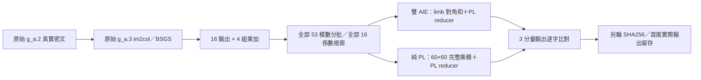

# 真實 g_a.3：原生純 PL 與雙 AIE 比較

這是新的測試套件；沿用已驗證的兩個硬體映像，**沒有新增 AIE 或改動原始 v32**。
目前沒有 g_a.3 板上效能數字，不能先宣稱哪一種較快。

## 這次比較什麼

- 真實輸入由原始 `g_a.0 → g_a.2 → g_a.3` 產生，沒有降低安全參數或換成隨機測資。
- 原層 N＝131072，完整有效 L＝53，BSGS 每組 K＝16。
- 16 個有效輸出密文，每個有 4 組密文乘加，共 64 組。不是 64 顆 AIE。
- 本次使用完整資料，涵蓋 **全部輸出、全部乘加組、全部 53 個模數與全部係數**。
- 53 個模數分成 16＋16＋16＋5；131072 個係數分成 16 個 8192 係數視窗，兩條管線各處理一個視窗的一半。
- 兩個候選都用 2 條管線、225 MHz PL、相同資料、順序、主機排程和逐字驗證。
- 檔名中的「係數」沿用舊格式欄位；實際切分的是原始 N＝131072 的 **NTT 評估值索引**，沒有把它重新轉成小環或重做 NTT。
- 全部資料約 **43.06 GiB**，壓縮後仍很大，但只需上傳一次。每次只載入一小批，不要求板子有 43 GiB RAM。
- **視窗中位數加總不是整層端到端時間**；stream 另列完整 raw MAC 資料串流時間，仍不含原層的旋轉等其他步驟。



FPGA 比較的是原層內的 raw MAC。旋轉、im2col、重線性化、偏差相加、g_a.5 啟動函數仍在本機原後端處理。
本機已擷取完整 g_a.3 與 g_a.5 的 CPU 參考；新的板上結果仍待你執行後回傳驗證。圖中的分批包含全部係數。

## 傳到遠端 Windows

上傳資料夾為 `v32_ga3_20261104`，另有 `v32_ga3_20261104_gitdata` 的傳輸工具與資料分片。
完整測資壓縮後為 **39,334,819,787 bytes（36.63 GiB）**。延用你原本的 Git 搬移方式時，要分成 37 批；請讀 gitdata/meta 的 `TRANSFER_README.md`，不要一次強制加入全部分片。
分片預設被這個新資料夾自己的 `.gitignore` 忽略；`push_all_batches.ps1` 會核對 SHA256 後才逐批加入、commit、push。普通 `git add .` 只會加入程式及傳輸說明。

另附同一 GitHub 倉庫的 Release 傳輸選項，避免把 36.63 GiB 大資料永久放入 Git 歷史；**目前沒有替你建立或發布 Release**。只選一種方式搬資料，兩種方式還原的壓縮檔完全相同。

如果使用普通 Git 分批，遠端 Windows `git pull origin main` 後，在 CMD 執行：

```bat
powershell.exe -NoProfile -ExecutionPolicy Bypass -File ".\v32_ga3_20261104_gitdata\meta\restore_data.ps1"
```

程式會逐片核對並重組壓縮檔，列印 `PASS_RESTORED_ORIGINAL_ARCHIVE` 與 SHA256。
如果選擇 Release，待你完成發布後，遠端改用 `meta/download_release_data.ps1`，它會下載、續傳、核對並還原同一個檔案；僅有 `git pull` 不會下載 Release 附件。
將 **`v32_ga3_20261104` 資料夾及還原出的 `v32_ga3_20261104_data.tar.gz`** 用 SFTP 傳到板子的 `/root/114C75007/vek280/AIE/`。
不需要遠端 Windows 安裝原始 v32、Python 或 OpenFHE。
板上需同時容納約 36.63 GiB 壓縮檔和 43.07 GiB 解壓資料，請先用 `df -h /` 確認空間；不要放進 FAT 開機分割區。

## 板上第一次執行

以下每行分開執行，全部是板子 Linux 指令：

```sh
cd /root/114C75007/vek280/AIE/v32_ga3_20261104
python3 unpack_data.py ../v32_ga3_20261104_data.tar.gz
sh check_package.sh
sh build_board.sh
python3 ga3_board.py detect
```

如果 detect 是 `v32_core_2_pipe`，現在就能先測雙 AIE，無須為了新主機程式重開機：

```sh
sh run_board.sh smoke
sh run_board.sh windows descending
sh run_board.sh windows ascending
sh run_board.sh stream descending
sh run_board.sh export descending
```

- `smoke`：只驗首尾兩個視窗，包含最後 L＝5，不能當正式效能。
- `windows`：全部 1024 個視窗各有 1 次暖機＋3 次量測；CPU 前測、硬體、CPU 後測使用同一份已載入資料。彙整的是**視窗中位數加總**，不是連續整層延遲。
- `stream`：一次依序處理全部 4096 個 raw MAC 作業，包含載入與逐字驗證，setup 另列。它涵蓋全部係數，但仍不是原層端到端時間。
- `export`：另輪重算，所有已測輸出都保留實際 SHA256，預設保留首尾視窗的 8 個實際輸出檔；雜湊和存檔不混入 windows 或 stream 效能。

若希望另輪保存全部視窗的實際輸出，可用 `V32_GA3_EXPORT_ALL=1 sh run_board.sh export descending`，會增加約 9.94 GiB 的未壓縮輸出。
預設的雜湊連結驗證，會清楚區分「下載的實際位元組」、「與原參考 SHA256 相同的重建位元組」及「未上板測試係數」。

## 換純 PL，然後回測 AIE

先檢查，再明確 arm。腳本會備份 slot 1，保留原 BOOT.BIN／slot 2，**不會自行重開機**：

```sh
sh switch_board.sh v32_native_pl_2_pipe check
sh switch_board.sh v32_native_pl_2_pipe arm
sync && reboot
```

重開後重新連線、回到本資料夾，先 detect 確認 `v32_native_pl_2_pipe`，再依序跑相同五個測試。
接著以相同步驟換回 `v32_core_2_pipe`，第三次開機再跑同一組，形成 **AIE → PL → AIE**。
若需恢復暫時 IP，在板子序列終端機用 `ip addr replace 192.168.10.98/24 dev end0`。

有任何 FAIL 請保留結果資料夾與文字輸出；不要同時跑其他 CKKS 套件。
如果主機控制程式在硬體子程序仍運作時中斷，工具會先停止自己啟動的子程序並保留恢復標記；由於無法確認 PL／AIE 已完整停止，須重新開機後才允許新一輪測試，不能直接刪標記略過。
CPU 時脈、負載、溫度、開機 UUID、二進位雜湊與逐次數據都會保留。CmaFree 只作診斷，實際 XRT BO 配置仍必須成功；腳本不清除全域快取。
CPU 對照使用板上雙核心 ARM 的相同 raw MAC，不是完整 OpenFHE 卷積或最佳化 CPU 的宣稱。

每次開機確認映像正確後，也可用 `sh run_round.sh` 依序完成上述五項測試。完整版本資料量大，載入與完整校驗可能需要較久；工具會保留進度、已完成與失敗結果，請不要在正在執行時另開一輪。

## 本機已完成的檢查

`OFFLINE_VERIFICATION.json` 與 `offline_evidence/ga3_local/` 保留本輪證據：完整 4096 作業、1,333,788,672 words 的軟體模型比對；64 組 raw MAC 的原上下文重線性化／解密／平方驗證；256 個 baby 密文與 g_a.3、g_a.5 共 32 個完整輸出回填比對；ASan／UBSan／TSan 與傳輸還原測試。

這些是**離線正確性與主機程式檢查**，不是這次 g_a.3 的板上執行、硬體模擬或效能成績。新的 ARM 主機二進位仍須在板上編譯，真實 PL／AIE 輸出回傳後還要再做獨立原上下文驗證。

## 要回傳哪個檔案

三次開機都完成後：

```sh
python3 summarize_campaign.py
python3 collect_results.py
```

下載最後列出的 `collected_ga3_*.tar.gz`。壓縮使用 gzip level 1，會顯示進度，不用傳回大型輸入測資或 bin 資料夾。

## 硬體成本與選擇標準

| 已佈線的整體設計資源 | 雙 AIE | 原生純 PL |
|---|---:|---:|
| AIE 運算 tile | 2 | 0 |
| PL LUT | 35,857 | 34,031 |
| PL FF | 45,748 | 45,402 |
| DSP | 334 | 420 |
| BRAM36 等效 | 25 | 39 |
| PL 時脈 | 225 MHz | 225 MHz |

這是沿用相同映像的既有佈線報告數字，不是 HLS 估算，也不是只計乘法器。完整來源雜湊列在 HARDWARE_PROVENANCE.json。
純 PL 使用較多 DSP／BRAM，雙 AIE 保留異質運算的擴充方向。先看兩種順序與 AIE 回測的時間，再看 pack、sync、執行與驗證占比；不以一次最快值決定整個專案，也不把 h_s.4 的勝負直接套到 g_a.3。
本輪能決定後續優先投入哪條路；原 g_a.3 的完整即時接入，以及 g_a.6／g_a.9，仍需後續實作與實測。
